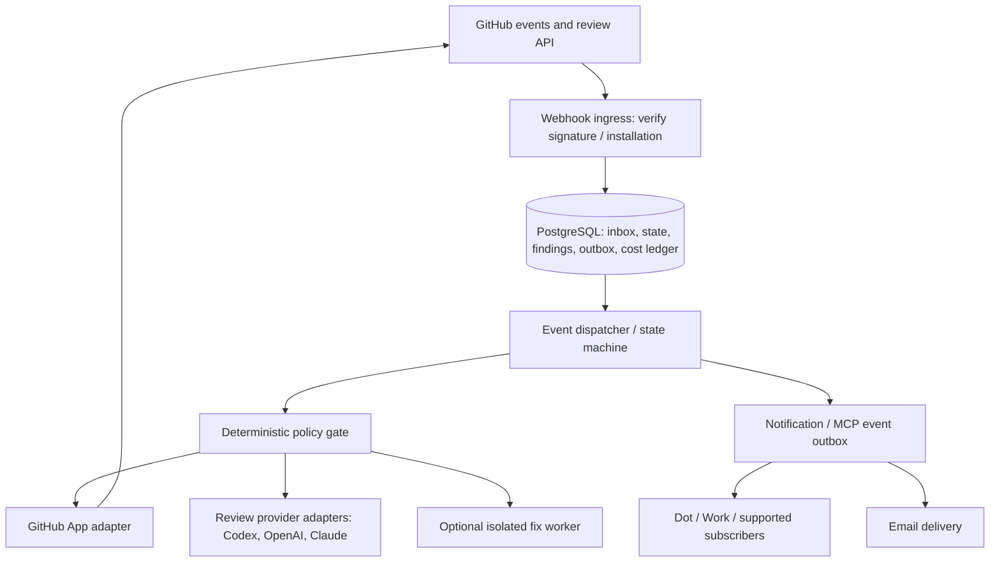

# Architecture overview

**Target architecture:** the application bootstrap and [PostgreSQL/Flyway schema](../development/database.md) exist. The orchestration components below are not yet implemented.

## Context

The application is an independent orchestration control plane for multiple repositories. It reacts to GitHub events, tracks the current review state and delegates optional analysis or fixing to adapter-backed workers. Initial consumers: Dokene and Monada Neuron. GitHub and GitHub Apps are first integration targets, not the domain model.

## Component diagram

## Modules (logical packages, names provisional)

- `domain`: `PullRequestIdentity`, `ReviewCycle`, `Finding`, `PolicyDecision`, `BudgetReservation`, invariant-rich state transitions.
- `application`: ingest event, reconcile PR state, request review, handle findings, schedule retry, notify author; transaction boundaries.
- `ports`: `PullRequestRepository`, `ReviewProvider`, `GitHubIdentityProvider`, `BudgetLedger`, `NotificationPublisher`, `EventPublisher`, `Clock`.
- `adapters/github`: signed webhook controller, GitHub App auth, REST/GraphQL clients, review/thread correlation.
- `adapters/persistence`: PostgreSQL, Flyway, transactional inbox/outbox.
- `adapters/ai`: optional OpenAI and Claude review decision adapters.
- `adapters/mcp`: optional MCP tools and event delivery.
- `worker`: async dispatcher / isolated fix execution, only after authorization.
- `observability`: trace, structured audit metadata, provider latency/cost metrics.

## Consistency and idempotency

Acknowledge GitHub after persisting a validated delivery; process asynchronously. Distinguish `deliveryId` (transport retry), `eventId` (domain event), and `commandKey` (side-effect dedupe: installation/repo/PR/head SHA/stage/provider). Reconcile current head SHA before any GitHub write. A later PR update invalidates stale clean verdicts.

Use outbox patterns for external side effects, at-least-once retries, dedupe at command boundary and dead-letter/poison event visibility. Do not claim end-to-end exactly-once behavior over GitHub APIs.

## Isolation

Installation/repository boundaries are explicit. Scope tokens by action; never store personal access tokens as plaintext or expose them to AI workers. Any future multi-tenant SaaS model must specify isolation in a new ADR before implementation.

## Further reading

[Review lifecycle](review-lifecycle.md) · [Domain model](domain-model.md) · [Integration contracts](integration-contracts.md) · [Threat model](../security/threat-model.md) · [ADRs](../adr/README.md)
