# Review lifecycle and stop conditions

**Specification, not deployed behavior.** Govern all transitions with a deterministic policy evaluated against current repository state.

```mermaid
stateDiagram-v2
  [*] --> NEW
  NEW --> WAITING_FOR_REVIEW: PR ready; valid installation
  NEW --> PAUSED: draft / disabled
  WAITING_FOR_REVIEW --> REVIEWING: budget + dedupe gates pass
  REVIEWING --> ACTION_REQUIRED: blocking findings
  ACTION_REQUIRED --> WAITING_FOR_FIX: author informed
  WAITING_FOR_FIX --> WAITING_FOR_REVIEW: new SHA + eligibility checks
  REVIEWING --> DEEP_REVIEW: clean baseline for head SHA
  DEEP_REVIEW --> ACTION_REQUIRED: findings
  DEEP_REVIEW --> READY_FOR_HUMAN: clean + CI passing + current SHA
  REVIEWING --> PAUSED: provider error / stale evidence
  WAITING_FOR_REVIEW --> BUDGET_EXHAUSTED: cap reached
  DEEP_REVIEW --> BUDGET_EXHAUSTED: cap reached
  READY_FOR_HUMAN --> WAITING_FOR_REVIEW: new commit
```

## Trigger gate

PR must be open and ready (not draft), authorized for the installation, not blocked by a human hold, and at an eligible head SHA. Hold duplicate provider/stage/SHA commands, CI state, current pending findings and in-flight requests. Do not issue review requests in response to the orchestrator's own comments.

## Iteration policy

Default **proposal**: max six automatic review requests per PR across the configured review loop. Count failed/retried external requests separately from successful review cycles so retries cannot bypass quota. Stop on lack of progress, repeated identical findings, budget exhaustion, unresolved authentication, stale head or incomplete webhook interpretation. Additional runs require documented operator approval and separate budget.

## Verdict contract

- `BLOCKED`: confirmed blocking issue or CI failure.
- `ACTION_REQUIRED`: remediation or explicit disposition pending.
- `NEEDS_HUMAN`: ambiguous general comment, policy disagreement, inaccessible status, or exhausted limits.
- `CLEAN_FOR_SHA`: no detected blocking findings in the current stage for **exact SHA**, not an assertion of full correctness.
- `READY_FOR_HUMAN`: all policy-required review stages clean at current SHA, CI passing and no unresolved blocking findings.

## General vs inline findings

GitHub review-thread resolution only applies to resolvable conversations. General PR issue comments / review body feedback have no resolve control. Track them as local findings with stable IDs and explicit dispositions (`fixed at SHA`, `won't fix with reason`, `false positive with reason`, `needs verification`). A changed SHA triggers re-validation; never confuse “acknowledged” with “fixed”.

## Notifications

Send human notifications only for state changes (ready, paused, budget, required intervention) with a per-recipient dedupe key. Default notice for clean review: link to PR, SHA, provider stages, CI evidence and caveat that the code still requires human merge authorization.
