# Review lifecycle and stop conditions

**Internal state machine implemented; live orchestration remains planned.** Issue #15 supplies persistent guarded transitions and clean evidence for exact head SHAs. See the [action/guard table, caller trust contract and verification](../development/review-state-machine.md). The diagram below is the broader target workflow; Provider dispatch remains disabled by default.

```mermaid
stateDiagram-v2
  [*] --> NEW
  NEW --> WAITING_FOR_REVIEW: PR ready; valid installation
  NEW --> PAUSED: draft / disabled
  WAITING_FOR_REVIEW --> REVIEWING: budget + dedupe gates pass
  REVIEWING --> ACTION_REQUIRED: blocking findings
  ACTION_REQUIRED --> WAITING_FOR_FIX: author informed
  WAITING_FOR_FIX --> WAITING_FOR_REVIEW: new SHA + eligibility checks
  REVIEWING --> DEEP_REVIEW: clean baseline for head SHA
  DEEP_REVIEW --> ACTION_REQUIRED: findings
  DEEP_REVIEW --> READY_FOR_HUMAN: clean + CI passing + current SHA
  REVIEWING --> PAUSED: provider error / stale evidence
  WAITING_FOR_REVIEW --> BUDGET_EXHAUSTED: cap reached
  DEEP_REVIEW --> BUDGET_EXHAUSTED: cap reached
  READY_FOR_HUMAN --> WAITING_FOR_REVIEW: new commit
```

## Trigger gate

PR must be open and ready (not draft), authorized for the installation, not blocked by a human hold, and at an eligible head SHA. Hold duplicate provider/stage/SHA commands, CI state, current pending findings and in-flight requests. Do not issue review requests in response to the orchestrator's own comments.

For remediation, [issue #20's correlation use case](../development/fix-correlation.md) waits for close head updates to settle and checks the committed tree against the remediation base. It records at most one candidate for the eligible head. The candidate feeds the separate CI, iteration and dispatch gates.

## Iteration policy

[The internal iteration policy](../development/ci-and-iteration-policy.md) starts with six automatic request slots per PR across providers and stages. Persisted reservations count even when a send fails or its outcome is uncertain. Exhaustion and identical findings in consecutive authenticated rounds pause the PR for human triage. Financial approval and budget enforcement remain separate.

## Verdict contract

Issue #19 implements [derived review outcomes](../development/review-outcomes.md): `CLEAN_FOR_SHA`, `ACTION_REQUIRED`, `NEEDS_HUMAN` and `UNKNOWN`. These are stage results; CI and readiness remain separate policy gates. Only clean outcomes can construct version-bound clean-stage transitions. Request/cycle correlation and retained findings are checked transactionally; provider completion authentication and current remote input gathering remain trusted integrations.

- `BLOCKED`: confirmed blocking issue or CI failure.
- `ACTION_REQUIRED`: remediation or explicit disposition pending.
- `NEEDS_HUMAN`: ambiguous general comment, policy disagreement, inaccessible status, or exhausted limits.
- `CLEAN_FOR_SHA`: no detected blocking findings in the current stage for **exact SHA**, not an assertion of full correctness.
- `READY_FOR_HUMAN`: all policy-required review stages clean at current SHA, CI passing and no unresolved blocking findings.

## General vs inline findings

GitHub review-thread resolution only applies to resolvable conversations. General PR issue comments / review body feedback have no resolve control. Track them as local findings with stable IDs and explicit dispositions (`fixed at SHA`, `won't fix with reason`, `false positive with reason`, `needs verification`). A changed SHA triggers re-validation; never confuse “acknowledged” with “fixed”.

Issue #17 implements [general findings and audited internal dispositions](../development/general-feedback.md). Acknowledgment and commit-bearing fix claims remain blocking; explicit dismissal applies only to a source revision at the current head. Persisted guards protect all clean-stage transitions and revoke existing clean readiness when new pending feedback arrives.

## Notifications

The [opt-in GitHub author notification worker](../development/author-notifications.md) sends on entry into ready-for-human or action-required states. Each notice is tied to the PR's head SHA and verified author, with CI and review evidence and a next action.
